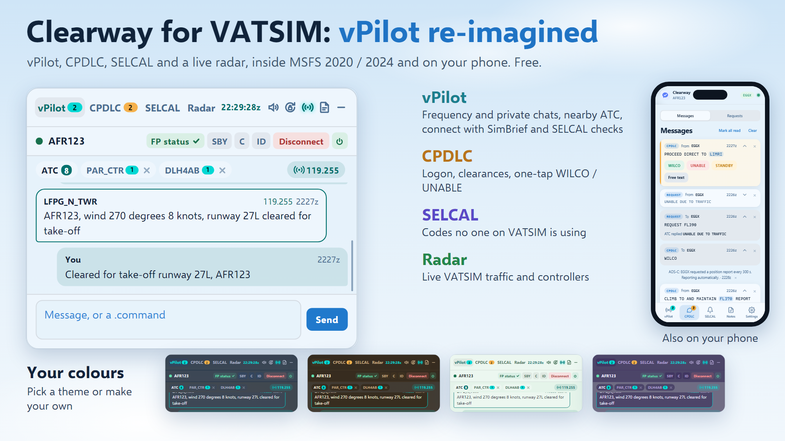
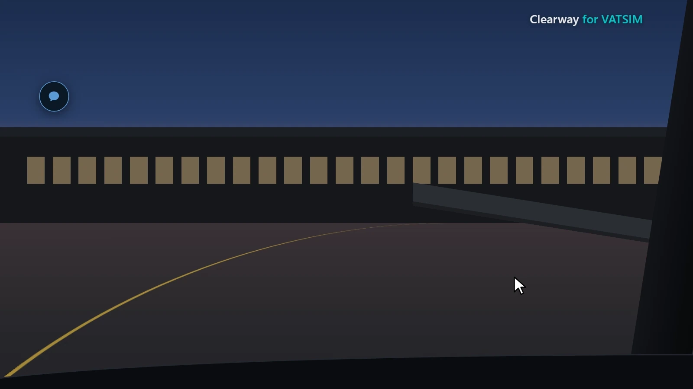
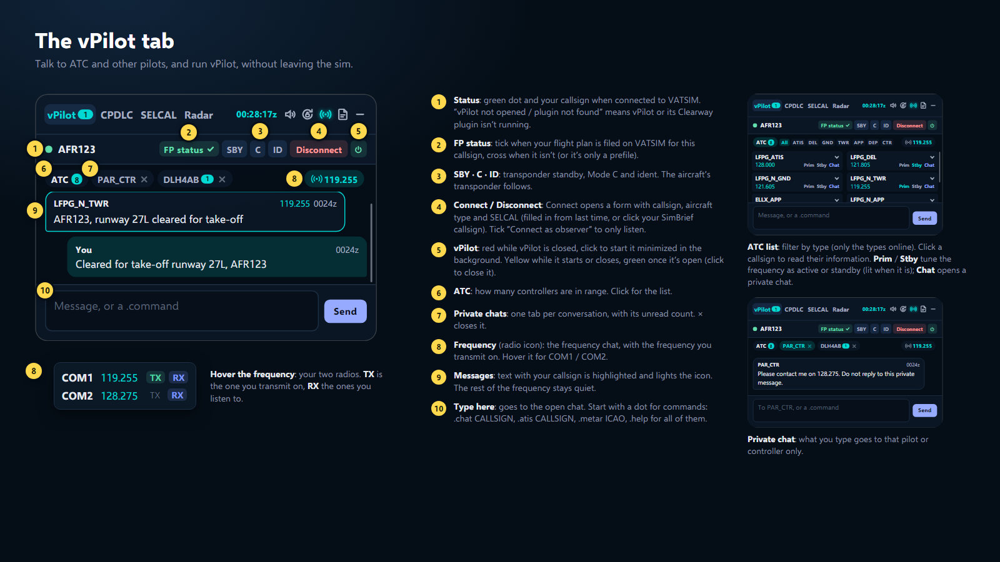
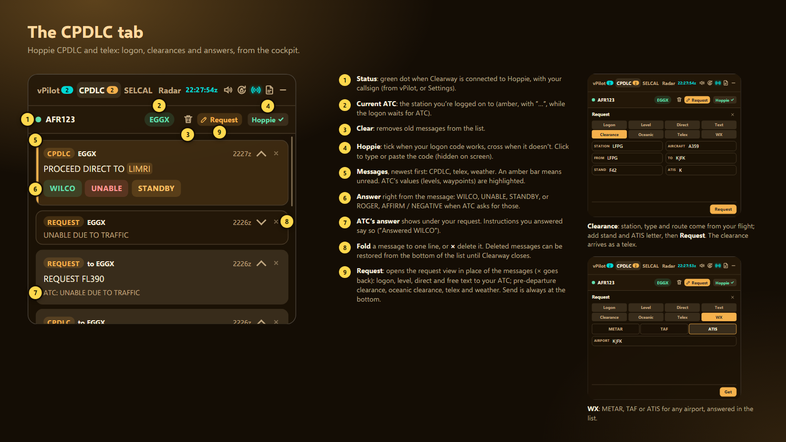
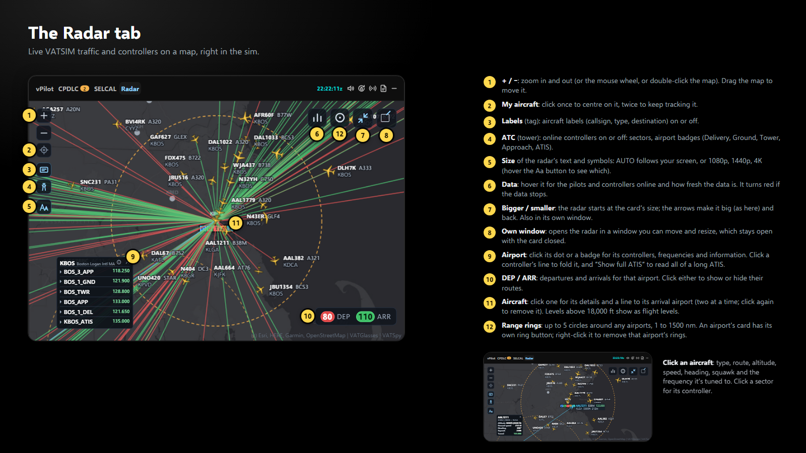
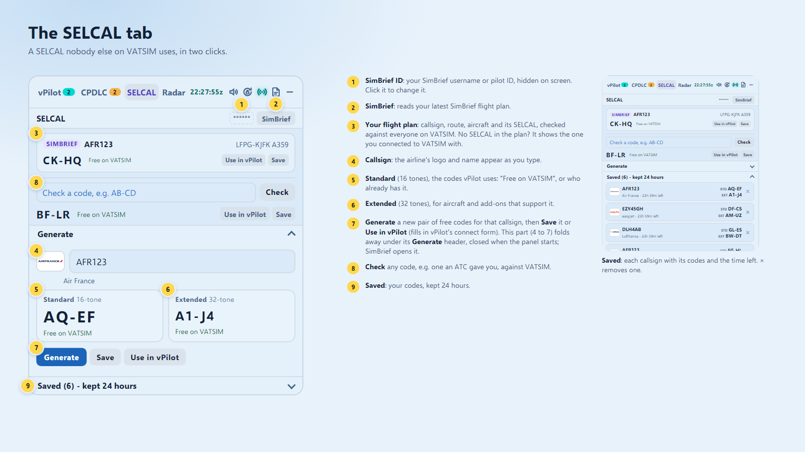
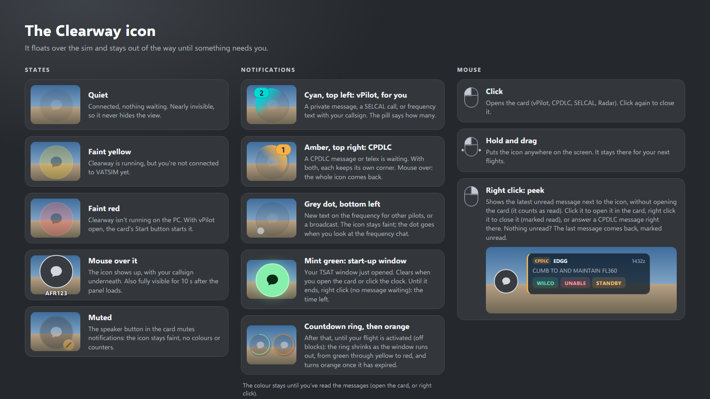
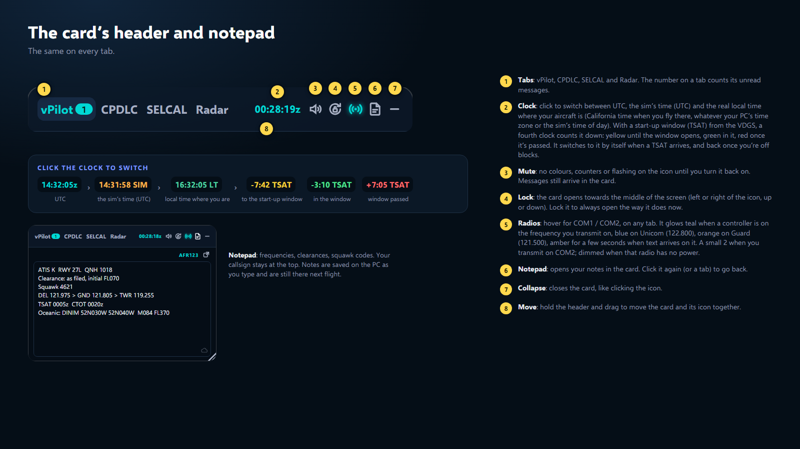
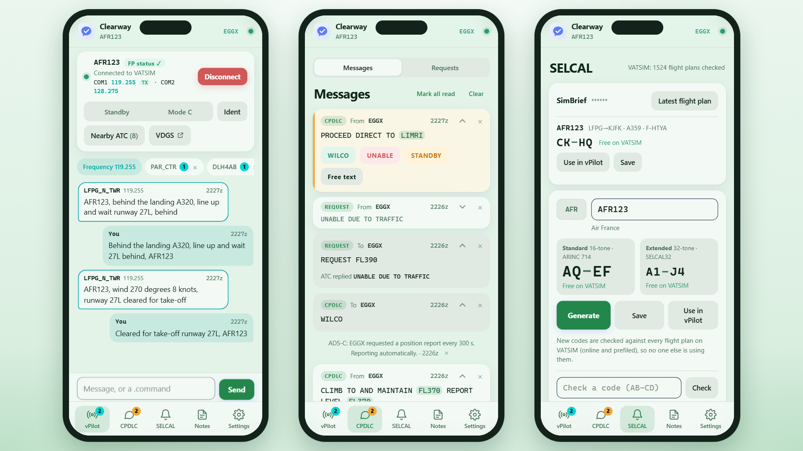

# Clearway for VATSIM

**vPilot, CPDLC, SELCAL and a live radar, inside MSFS and on your phone.** Free, no accounts, nothing to pay.

A small Windows companion app feeds an in-game MSFS toolbar panel (a floating icon you put anywhere) and a phone web app (iPhone or Android). Both stay in sync.

<p align="center"></p>
<p align="center"></p>
<p align="center"></p>
<p align="center"></p>
<p align="center"></p>
<p align="center"></p>
<p align="center">
  <a href="docs/howto-icon.png"></a>
  <a href="docs/howto-header.png"></a>
</p>
<p align="center"></p>

## Features

| | |
|---|---|
| **vPilot** | Frequency and private chats, nearby ATC and ATIS, connect or observe, transponder, dot commands. Warns when your flight plan isn't filed |
| **TSAT clock** (MSFS panel) | After you submit your TOBT at vats.im/vdgs, the panel clock counts down to your start-up window (yellow, green inside the window, red when late) |
| **CPDLC** (Hoppie) | Logon, departure and oceanic clearances, requests, one-tap WILCO / UNABLE, automatic ADS-C |
| **SELCAL** | Codes no one on VATSIM is using, SimBrief import, check any code |
| **Radar** (MSFS panel) | Live VATSIM traffic, controllers and sectors, airport info. Detach it into its own window |

**Also:** phone notifications with quick replies (free ntfy app) · right-click the panel icon to peek and reply · typing in the panel never triggers sim or ChasePlane shortcuts · shared notepad · METAR, TAF and ATIS · light or dark theme · runs as a small tray app

## How it works

```
 Hoppie ACARS  ◄──►  Clearway (your PC)  ◄──►  MSFS panel  (localhost)
                         │      ▲
                         │      └──────────►  phone web app (home Wi-Fi) 
                         └──► ntfy.sh ─────►  phone lock-screen notifications
```

Only the companion talks to Hoppie, so the phone and the panel never compete for messages. Your Hoppie logon code stays on your PC. Notifications contain only the message text.

## Setup

Download **`Clearway-for-VATSIM-<version>.zip`** from the [Releases](../../releases) page (or flightsim.to). It contains everything: the MSFS panel, the Clearway companion app and the vPilot plugin.

### 1. The MSFS panel

1. Extract the zip into your MSFS **Community** folder. You get a `clearway-panel` folder there.
   - MSFS 2020, MS Store / Xbox app: `%LOCALAPPDATA%\Packages\Microsoft.FlightSimulator_8wekyb3d8bbwe\LocalCache\Packages\Community`
   - MSFS 2020, Steam: `%APPDATA%\Microsoft Flight Simulator\Packages\Community`
   - MSFS 2024, MS Store / Xbox app: `%LOCALAPPDATA%\Packages\Microsoft.Limitless_8wekyb3d8bbwe\LocalCache\Packages\Community`
   - MSFS 2024, Steam: `%APPDATA%\Microsoft Flight Simulator 2024\Packages\Community`
   - Custom location: check `InstalledPackagesPath` in `UserCfg.opt`

### 2. The companion (Windows)

1. Run `Community\clearway-panel\Clearway companion\Clearway.exe` (keep the `_internal` folder next to it). There is no window: Clearway runs as an icon next to the clock. **Double-click** the icon to open it; **right-click** it to connect, disconnect or quit. Keep it running while you fly. Tip: make a desktop shortcut.
2. Windows SmartScreen may warn because the app isn't signed: **More info → Run anyway**. Windows Firewall will ask about network access: allow **Private networks**.
3. The first time, your browser opens Clearway's **Settings** (later, double-click the tray icon). Enter:
   - your **Hoppie logon code** (free at [hoppie.nl/acars](https://www.hoppie.nl/acars/system/register.html)); you can also paste it in the panel's CPDLC tab
   - your **VATSIM CID**

### 3. The vPilot plugin

1. Close vPilot and copy `Clearway companion\vPilot plugin\Clearway.vPilot.dll` into vPilot's `Plugins` folder (right-click the vPilot shortcut > **Open file location** > `Plugins`; usually `C:\Users\<you>\AppData\Local\vPilot\Plugins`).
2. **Unblock it:** right-click `Clearway.vPilot.dll` > **Properties** > tick **Unblock** > OK. Windows marks downloaded files, and vPilot silently ignores a blocked plugin (Clearway then shows "vPilot not opened / plugin not found").
3. Start vPilot again.

The **vPilot** tab (MSFS panel, phone and PC page) then works like vPilot's own window:

- **Frequency** chat with everything on frequency (messages that mention you are highlighted and alert you), controller info (ATIS), METARs, broadcasts and SELCAL alerts
- one tab per **private chat**; close a tab with × or `.close`
- **Nearby ATC** with frequencies and distance; the arrow next to a controller shows their information
- **Connect** (with SimBrief callsign and SELCAL checks) or connect as an observer, **Disconnect**, **Standby / Mode C** and **Ident**, and the **FP status** of your flight plan on VATSIM
- dot commands: `.chat` `.msg` `.close` `.atis` `.wx` `.metar` `.wallop` `.clear` `.copy`, plus `.modec` `.standby` `.ident` `.connect` `.disconnect` and `.help`

vPilot doesn't let plugins set the squawk code or tune radios, so `.x`/`.squawk`, `.com1`, `.com2`, `.com`, `.ctaf`, `.towerview`, `.aircraft`, `.debug`, `.reloadrules` and `.ignore` still need vPilot's own window. Clearway tells you when you type one.

### 4. Your phone (optional, iPhone or Android)

1. Make sure the phone is on the same Wi-Fi as the PC.
2. In Clearway on the PC, open **Settings** and scan the **Pair your phone** QR code with the phone's camera.
3. Add the page to your home screen: on iPhone, Safari **Share → Add to Home Screen**; on Android, Chrome **⋮ → Add to Home screen**.
4. For notifications, install **ntfy** from the App Store or Google Play (free, no account). Tap **+** and subscribe to the topic shown in Clearway's Settings. Press **Send test** to check.

> Notifications arrive anywhere, but replying from the phone needs your home Wi-Fi.
### In the sim

Click the Clearway icon in the toolbar. A small round icon appears:

- **click** it to open or collapse the card (tabs: vPilot, CPDLC, SELCAL, Radar)
- **drag** it anywhere on screen (the position is remembered)
- **right click** it to peek at the latest unread message (vPilot first) and answer it; with nothing unread, it marks the latest message unread again
- it turns **solid** when a message arrives (cyan for vPilot, amber for CPDLC) until you read it; the speaker button in the card mutes this

The panel is a transparent full-screen layer, and only the icon and card catch the mouse. It's designed for 16:9 screens (1080p, 1440p, 4K) and works in MSFS 2020 and 2024.

> **Ultrawide screens:** MSFS gives a toolbar panel a fixed area on the right of the screen and doesn't fit it to the screen, so there's one download per screen shape (the resolution doesn't matter, only the shape):
>
> | Screen | Examples | Download |
> |---|---|---|
> | 16:9 | 1920×1080, 2560×1440, 3840×2160 | `Clearway-for-VATSIM-<version>.zip` |
> | 21:9 | 2560×1080, 3440×1440, 5120×2160 | `Clearway-for-VATSIM-21-9-wide-<version>.zip` |
> | 32:9 | 3840×1080, 5120×1440, 7680×2160 | `Clearway-for-VATSIM-32-9-wide-<version>.zip` |
>
> With the standard download on an ultrawide screen everything works, but the left part of the screen is out of reach. A wider version on a narrower screen puts part of the panel off the screen. If the icon or a window ever ends up out of view (after changing resolution, or switching between windowed and fullscreen), press **Settings › Options › Reset panel positions** in Clearway.

While you type in a panel text field, Clearway keeps the keys away from MSFS key bindings and from programs such as ChasePlane, so typing never moves the camera or flips a switch. Controllers (yoke, throttle, joystick) keep working. Press **Esc** or click anywhere outside the panel to hand the keyboard back. This can be switched off in Clearway's settings.

## Using it

1. In **Requests → ATC logon**, enter the station (e.g. `EGGX`, `CZQX`, `KZNY`) and press **Log on**.
2. Messages from ATC appear with answer buttons. Answer from the phone, the panel, or straight from the notification.
3. Tap a message without answer options to acknowledge it.

## Building from source

The companion needs Python 3.11+ with only the standard library. To run it:

```bash
cd companion
python clearway_app.py
```

Or double-click `companion/Clearway.pyw` to run it from source with only the tray icon, no console window.

To test without the real network, run against a fake Hoppie server:

```bash
python tools/dev_run.py
```

To build the Windows app (`dist/Clearway/`, an exe with its support folder):

```bash
pip install pyinstaller==6.11.1
python tools/build_exe.py
```

For the MSFS panel you need the free MSFS SDK. The SDK's package tool briefly starts the sim to compile the panel:

```bash
python tools/build_panel.py --install
```

The compiled panel definition is cached in `msfs-panel/compiled/`. Commit it, so GitHub Actions can package releases without the SDK.

The vPilot plugin is a small C# library for .NET Framework 4.7.2. It builds against the plugin interface that ships with vPilot, which is not redistributed here:

```bash
cd vpilot-plugin
dotnet build -c Release
```

Copy the result to `vpilot-plugin/compiled/` and commit it, so releases can include it.

Releases are built by GitHub Actions when you push a tag such as `v0.1.0`.

For sites like flightsim.to, `python tools/make_release_zip.py` builds one all-in-one zip: a `clearway-panel` folder for the Community folder, with `Clearway companion\` (the exe, the vPilot plugin and a quick-start guide) inside it.

## Project layout

```
companion/            Python companion (no third-party packages)
  clearway/           Hoppie client, CPDLC session, ntfy, web server
  web/                phone and desktop web app
msfs-panel/           MSFS toolbar panel package sources
vpilot-plugin/        vPilot plugin (C#) that bridges vPilot and Clearway
tools/                build scripts, icon generator, mock Hoppie server
```

## Credits

- Inspired by [EasyCPDLC](https://github.com/quassbutreally/EasyCPDLC) by Joshua Seagrave. Clearway is an independent implementation and contains no EasyCPDLC code.
- [Hoppie's ACARS](https://www.hoppie.nl/acars/) by Jeroen Hoppenbrouwers makes all of this possible.
- QR codes by [qrcode-generator](https://github.com/kazuhikoarase/qrcode-generator) (MIT).
- MSFS panel font: [Selawik](https://github.com/microsoft/Selawik) by Microsoft ([SIL Open Font License 1.1](msfs-panel/html_ui/InGamePanels/ClearwayPanel/fonts/Selawik-OFL.txt)).

Clearway is not affiliated with Hoppie, VATSIM, vPilot, ntfy or Microsoft. It's for flight simulation only.

## License

[MIT](LICENSE)
